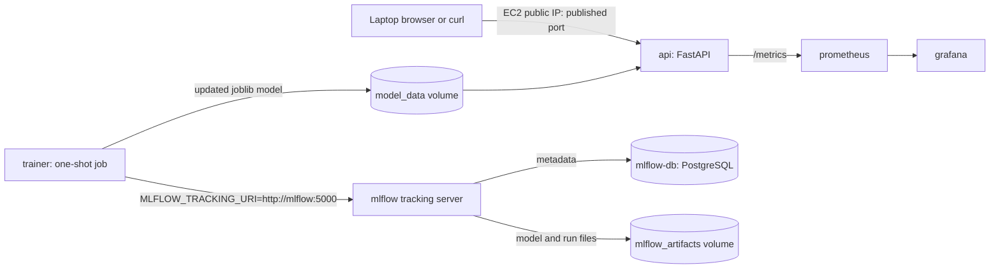

# Iris MLOps Learning Project

A small, reproducible scikit-learn classification project served through FastAPI. It uses scikit-learn's built-in Iris dataset, so training requires no dataset download. Training records parameters, held-out metrics, and the model in MLflow while retaining the local joblib artifact used by the API.

## Project layout

```text
app/       FastAPI application, request schemas, model loading
ml/        Reproducible training, evaluation, MLflow configuration, and registration example
models/    Locally generated model artifact (ignored by Git)
data/      Reserved for later data workflow exercises
tests/     API and model unit tests
```

## Local Docker Compose platform

The repository-root `docker-compose.yml` runs the existing API alongside PostgreSQL-backed MLflow, Prometheus, and Grafana. This is a single-machine learning environment; it does not create AWS resources or use Kubernetes. The Python virtual environment instructions below remain available for running and testing the application without Docker.



### What each container does

| Compose service | Purpose | Local access and persistence |
|---|---|---|
| `api` | Builds the existing FastAPI application and serves `/health`, `/predict`, and `/metrics`. The image includes a reproducible model created during the image build; container startup does not train it. | `http://EC2_PUBLIC_IP:8000` (or `http://127.0.0.1:8000` on the host); shares the `model_data` volume with the trainer. |
| `mlflow-db` | Stores MLflow experiments, runs, parameters, metrics, and registry metadata in PostgreSQL. | No host port is published; `postgres_data` is persistent. |
| `mlflow` | Provides the MLflow UI/API, connects to PostgreSQL, and proxies run-artifact uploads/downloads into its artifact directory. | `http://EC2_PUBLIC_IP:5000` (or `http://127.0.0.1:5000` on the host); `mlflow_artifacts` is persistent. |
| `trainer` | One-shot profile service that runs the existing `python -m ml.train` code and writes its joblib model to the shared model volume. | Not started by normal `docker compose up`; logs runs to `http://mlflow:5000`. |
| `prometheus` | Scrapes the API at `api:8000/metrics` every 15 seconds. | `http://EC2_PUBLIC_IP:9090` (or `http://127.0.0.1:9090` on the host); `prometheus_data` is persistent. |
| `grafana` | Provisions Prometheus as its data source and loads the API dashboard automatically. | `http://EC2_PUBLIC_IP:3000` (or `http://127.0.0.1:3000` on the host); `grafana_data` and dashboard files persist. |

The Compose images are version-constrained: API and trainer use the Python 3.13 image family with the repository's exact `requirements-lock.txt` constraints; MLflow and its PostgreSQL driver use MLflow 3.16.1 and psycopg2-binary 2.9.11; PostgreSQL uses `16.15-alpine3.24`; Prometheus uses the existing pinned `v3.5.5` image; and Grafana uses `13.2.2-slim`. No service uses a floating `latest` tag. For immutable production builds, pin each base image by digest and maintain security updates deliberately.

The four browser services are published on all EC2 host interfaces so they can be reached directly by public IP when the network allows it. PostgreSQL has no published port. **This does not make the services safe for unrestricted Internet exposure:** MLflow and Prometheus do not have application authentication configured, and Grafana/API use plain HTTP. For temporary learning access, add inbound EC2 security-group rules for TCP 8000, 5000, 9090, and 3000 with the source set to your current trusted public IP as `/32`. Never use `0.0.0.0/0` for these ports. If access is needed by changing users/IPs or for a longer-running environment, keep these service ports private and use HTTPS plus an authenticated reverse proxy with DNS and TLS. The SSH tunnel alternative is documented below.

### Prerequisites and environment setup

- Linux EC2 development machine (or another Docker host) with Docker Engine and the Docker Compose v2 plugin.
- Git checkout with enough disk space for the images, PostgreSQL data, MLflow artifacts, Prometheus time series, and Grafana data.
- Python is needed for the repository's local virtual environment and tests; the Compose services run in containers.

From the repository root, create an untracked local environment file and replace the example passwords with local, URL-safe values:

```bash
cp .env.example .env
python3 -c 'import secrets; print(secrets.token_urlsafe(32))'
```

Use one generated value for `POSTGRES_PASSWORD` and a different value for `GRAFANA_ADMIN_PASSWORD` in `.env`. Keep `MLFLOW_TRACKING_URI=http://mlflow:5000` for container-to-container training traffic. Replace both occurrences of `EC2_PUBLIC_IP` in `MLFLOW_ALLOWED_HOSTS` with the instance's current public IPv4 address (include the address both with and without `:5000`) so MLflow accepts browser requests to its public URL. Keep these values for this learning exercise only. Never use production credentials here or commit `.env`. The root `.gitignore` excludes `.env`, key material, generated MLflow files, Python caches, and Terraform state. The example file contains safe placeholders, not working production secrets.

### Build and start

Run all Compose commands from the repository root, not from `mlops/`:

```bash
docker compose config
docker compose build
docker compose up -d
docker compose ps
```

`docker compose config` validates and renders the configuration. Be careful when sharing its output: it may include values from your local `.env`. `docker compose build` builds the API, MLflow, PostgreSQL, Prometheus, and Grafana images. The optional training image has its own build command below. `docker compose up -d` starts the five long-running services. PostgreSQL is marked healthy before MLflow starts; Prometheus waits for the API health check; Grafana waits for Prometheus. Health checks use the service's readiness endpoint or built-in command. Docker publishes these host ports on `0.0.0.0`; an AWS security group and any host firewall still control whether remote clients can reach them.

Follow logs and check status with:

```bash
docker compose ps
docker compose logs -f api
docker compose logs -f mlflow
docker compose logs -f mlflow-db
docker compose logs -f prometheus
docker compose logs -f grafana
```

### Train and register a model in Compose

Build and run the one-shot training service when you want a new experiment. It uses the existing training pipeline, exact Python dependency constraints from `requirements-lock.txt`, the shared model volume, and the MLflow service hostname:

```bash
docker compose --profile training build trainer
docker compose --profile training run --rm trainer python -m ml.train
docker compose restart api
```

`docker compose restart api` reloads the just-trained model because the API caches its loaded model for its process lifetime. Normal API restarts never train. The API image also builds a reproducible fallback model, so a fresh `docker compose up -d` has a model even if you have not run the trainer yet. The named `model_data` volume is shared by the API and trainer, so subsequent API image rebuilds do not overwrite a model already stored in that volume.

Inside a container, `localhost` refers to that same container. The trainer must use `http://mlflow:5000`, where `mlflow` is the Compose service name; `localhost:5000` would point back to the trainer container. The current API does not call MLflow during prediction. It receives the same service URI in its environment for future integrations, while the trainer actively uses it through `MLFLOW_TRACKING_URI`.

The run records the existing experiment `mlops-iris-classifier`, its parameters, held-out `accuracy` and `macro_f1`, and the model artifact. Open [http://127.0.0.1:5000](http://127.0.0.1:5000) and select that experiment. **Backend metadata** (runs, parameters, metrics, and registry information) lives in PostgreSQL. **Artifacts** (logged models and run files) live in the MLflow artifact directory volume and are served by the tracking server. A logged model artifact is not automatically a registered model. To use the existing registration workflow after training:

```bash
docker compose --profile training run --rm trainer python -m ml.register_model
```

This registers a version using the existing `MLFLOW_MODEL_NAME` behavior/default; it does not deploy or promote the model. The local MLflow volume-backed store is separate from the existing Python workflow's SQLite `mlops/mlflow.db` and `mlops/mlruns/`, which remain usable without Docker.

### Use the API, Prometheus, and Grafana

From the Docker host:

```bash
curl http://127.0.0.1:8000/health
curl -X POST http://127.0.0.1:8000/predict \
  -H "Content-Type: application/json" \
  -d '{"sepal_length":5.1,"sepal_width":3.5,"petal_length":1.4,"petal_width":0.2}'
curl http://127.0.0.1:8000/metrics
```

The prediction request follows the existing `IrisFeatures` schema. The Prometheus UI is at [http://127.0.0.1:9090](http://127.0.0.1:9090); check [its targets page](http://127.0.0.1:9090/targets) and confirm the `ml-api` target is `UP`. The Compose scrape config targets `api:8000` on the internal Compose network. The application metric names are `http_requests_total` and `http_request_duration_seconds` (including `_bucket`, `_count`, and `_sum` histogram series). The provisioned Grafana dashboard reuses the Kubernetes dashboard queries for request rate, p95 latency, HTTP 5xx ratio, and scrape availability.

Open [http://127.0.0.1:3000](http://127.0.0.1:3000), sign in with `GRAFANA_ADMIN_USER` and `GRAFANA_ADMIN_PASSWORD` from `.env`, then open the `MLOps` folder and `ML API Overview` dashboard. The Prometheus data source is provisioned as `http://prometheus:9090` on the Compose network. No UI requires manual data-source configuration.

### Direct browser access from a laptop to EC2

After Compose is running, use the EC2 instance's **Public IPv4 address** or **Public IPv4 DNS** shown in the EC2 console. The Compose ports are published on the EC2 network interfaces, so the browser URLs are:

- FastAPI: `http://EC2_PUBLIC_IP:8000` (interactive docs at `/docs`)
- MLflow: `http://EC2_PUBLIC_IP:5000`
- Prometheus: `http://EC2_PUBLIC_IP:9090` (targets at `/targets`)
- Grafana: `http://EC2_PUBLIC_IP:3000` (log in with the user/password in `.env`)

Replace `EC2_PUBLIC_IP` with the actual address, or use the EC2 public DNS name. A public IP alone is not sufficient: the instance needs a public IPv4 address, a subnet route to an Internet Gateway, and security-group/firewall rules that permit the connection. Do not expose PostgreSQL port 5432; it has no published port.

**Approach A — temporary learning access:** in the EC2 console, open **EC2 → Instances → your instance → Security → Security groups → Edit inbound rules**. Add four **Custom TCP** inbound rules, one each for ports `8000`, `5000`, `9090`, and `3000`. Set **Source** on every rule to **My IP** (a single trusted IPv4 address with `/32`), not `Anywhere-IPv4` (`0.0.0.0/0`). If your public IP changes, update the rules. Do not add a port 5432 rule. AWS settings are intentionally left for you to review and apply manually. If a restrictive network ACL or host firewall is configured, it must also permit the traffic and return traffic.

Update the untracked `.env` on EC2 so `MLFLOW_ALLOWED_HOSTS` contains the instance's actual public IPv4 address twice: once by itself and once with `:5000`, for example `203.0.113.10,203.0.113.10:5000`, retaining the existing Compose/loopback entries. This allows MLflow's host validation to accept requests addressed to the public IP. Restart MLflow after editing: `docker compose up -d --force-recreate mlflow`.

Run these checks on EC2 after startup:

```bash
docker compose config --quiet
docker compose ps
sudo ss -lntp
curl -fsS http://127.0.0.1:8000/health
curl -fsS http://127.0.0.1:5000/health
curl -fsS http://127.0.0.1:9090/-/ready
curl -fsS http://127.0.0.1:9090/api/v1/targets
curl -fsS http://127.0.0.1:3000/api/health
docker compose exec api python -c "import urllib.request; print(urllib.request.urlopen('http://mlflow:5000/health').status)"
```

The Prometheus targets API response should show the `ml-api` target as `health: UP`. Then test the four public URLs from the laptop browser. If local curls work but remote access fails, verify the address, subnet route, security-group source CIDR, any host firewall, and that your laptop is using the same public IP entered in **My IP**. If MLflow responds with a host validation error, recheck `MLFLOW_ALLOWED_HOSTS` and recreate that service. If Grafana's password is not accepted, use the value in `.env`; Grafana's environment password only initializes a new data volume and does not reset an existing admin account.

**Approach B — safer long-running access:** do not open the four service ports to laptop or Internet ingress. Put an authenticated reverse proxy in front of the private services, configure DNS names, obtain TLS certificates, and enforce authentication/authorization at the proxy. Keep PostgreSQL and the backend service ports private. This requires DNS/TLS and proxy configuration and is not installed by this project. The current direct-access learning mode uses unencrypted HTTP; MLflow and Prometheus have no user authentication here, so even trusted-IP restrictions are a temporary mitigation, not production security. Grafana has a password, but HTTP still exposes credentials in transit. Do not reuse important credentials.

On EC2, create an SSH tunnel from your workstation (replace the host/user with yours):

```bash
ssh -L 8000:127.0.0.1:8000 -L 5000:127.0.0.1:5000 \
  -L 9090:127.0.0.1:9090 -L 3000:127.0.0.1:3000 ubuntu@YOUR_EC2_HOST
```

Then use the same `127.0.0.1` URLs in your workstation browser. Port 5432 is intentionally not forwarded or published.

### Stop, restart, and back up data

```bash
docker compose stop
docker compose start
docker compose down
```

These commands stop or remove containers and the Compose network but preserve named volumes. **Do not use `docker compose down -v` as a routine stop command**: that deletes PostgreSQL, MLflow artifact, Prometheus, Grafana, and model data volumes. If you intentionally want to reset all learning data, back it up first and remove volumes only after confirming the exact data-loss impact.

Example backups from the repository root (store backups somewhere outside this EC2 host as well):

```bash
mkdir -p backups
docker compose exec -T mlflow-db sh -c 'pg_dump -U "$POSTGRES_USER" "$POSTGRES_DB"' > backups/mlflow-metadata.sql
docker compose cp mlflow:/mlflow/artifacts ./backups/mlflow-artifacts
docker compose cp prometheus:/prometheus ./backups/prometheus-data
docker compose cp grafana:/var/lib/grafana ./backups/grafana-data
docker compose cp api:/app/models ./backups/models
```

The PostgreSQL dump contains MLflow metadata/registry state; the MLflow artifact copy contains model and run files. The other copies preserve monitoring state and the active joblib model. Back up while services are quiescent for a consistent snapshot, and test restoration before relying on a backup.

### Troubleshooting

- **Compose says variables are missing:** create `.env` from `.env.example`, then set the local database and Grafana passwords.
- **A port is already in use:** stop the conflicting local process, or change only the host side of the port mapping (for example `127.0.0.1:8001:8000`). The service-to-service ports stay unchanged.
- **MLflow does not become healthy:** inspect `docker compose logs mlflow mlflow-db`. Confirm PostgreSQL is healthy and the credentials match the existing `postgres_data` volume. Changing `.env` does not change the password inside an already initialized PostgreSQL volume; keep the old value or update the database role deliberately.
- **Prometheus target is down:** inspect `docker compose ps`, API health/logs, and `http://127.0.0.1:8000/metrics`; the target must be `api:8000`, not `localhost:8000`.
- **Prediction reports a missing model:** check that the API image built successfully and `model_data` is mounted. After training, restart the API to clear its in-process model cache.
- **Grafana says the data source is unavailable:** ensure Prometheus is healthy and use the provisioned internal address `http://prometheus:9090`, not `localhost:9090`.
- **Disk use grows:** named volumes persist after `docker compose down`; inspect them with `docker volume ls` and back them up before any cleanup.

### Docker Compose compared with Kubernetes

Compose runs named services on one Docker host and provides service-name DNS, health-based startup ordering, and local named volumes. It is useful for learning container networking and the MLflow database/artifact split. Kubernetes uses cluster scheduling, namespaces, Services, Deployments, HPA, persistent-volume claims, and controllers such as Argo CD; the existing `k8s/`, `monitoring/`, `argocd/`, and Terraform files remain unchanged and separate from this local Compose environment. Compose does not simulate EKS, multi-node failover, cloud IAM, or production persistence guarantees. **No AWS deployment is required or performed for this Compose setup.**

## Python setup

Use Python 3.11 or newer. From this directory, create and activate a virtual environment:

```bash
python -m venv .venv
# Windows PowerShell
.venv\Scripts\Activate.ps1
# macOS/Linux: source .venv/bin/activate
```

## Install dependencies

Install runtime dependencies to train, track, and serve the model:

```bash
python -m pip install --upgrade pip
python -m pip install -r requirements.txt
```

Install test tools for local development and testing:

```bash
python -m pip install -r requirements-dev.txt
```

To recreate the exact package versions resolved in the working Python 3.13.14 environment, install the lock file in a clean virtual environment instead:

```bash
python -m pip install -r requirements-lock.txt
```

The lock file captures this Python 3.13 environment; `requirements.txt` remains the cross-version runtime dependency specification.

## Train and evaluate

Training uses a stratified split and fixed random seed, writes `models/iris_pipeline.joblib`, and creates an MLflow run in the `mlops-iris-classifier` experiment. The default tracking URI uses a local SQLite metadata file (`mlflow.db`) and local run artifacts under `mlruns/`:

```bash
python -m ml.train
```

The run records model/split parameters, held-out `accuracy` and `macro_f1`, and the fitted scikit-learn pipeline as an MLflow model artifact. Training prints its run ID and MLflow model URI (`models:/<model-id>`); in MLflow 3 this identifies the logged model artifact and does not mean the model was added to a Model Registry. Set `MLFLOW_TRACKING_URI` to another supported tracking URI or pass `--tracking-uri` to direct a run elsewhere. Do not put production credentials in source files or command history; configure them through a trusted environment/secret mechanism when a secured remote tracking service is introduced. The Docker image build uses `--skip-mlflow` so image builds do not create experiment runs or embed a local tracking store.

Evaluate the saved model on the same reproducible held-out split:

```bash
python -m ml.evaluate
```

### View local MLflow experiments

Install MLflow with the project dependencies, then start the local UI from this directory:

```bash
python -m mlflow ui --backend-store-uri sqlite:///mlflow.db --host 127.0.0.1 --port 5000
```

Open `http://127.0.0.1:5000` and select `mlops-iris-classifier`. Stop the UI with Ctrl+C. Training writes directly to the local SQLite file and does not require a separate tracking server or database server.

### MLflow lifecycle: local learning and production

The workflow has six lifecycle concepts:

1. **Experiment:** `mlops-iris-classifier` groups related Iris classifier training attempts.
2. **Run:** each `python -m ml.train` invocation creates a run with a unique run ID.
3. **Parameters:** the run records model choice, random seed, split size, solver, iteration limit, and train/test row counts.
4. **Metrics:** held-out `accuracy` and `macro_f1` make runs comparable.
5. **Model artifact:** the fitted scikit-learn pipeline and MLflow environment metadata are stored with the run. The API continues loading its local joblib artifact; this phase does not change API model loading.
6. **Model version and promotion:** `ml/register_model.py` registers a logged model artifact as a version under a configurable registered-model name. The new version is tagged `pending_review`; after a human validates it, an explicit alias assignment can label it `staging` or `production`.

#### Local learning setup

- **Local tracking:** training writes run metadata to the SQLite file `mlflow.db`. `MLFLOW_TRACKING_URI` overrides this default. No HTTP tracking server is required; `mlflow ui` reads the local store for viewing runs.
- **Artifact storage:** model files and run artifacts are stored locally under `mlruns/`. Both `mlflow.db` and `mlruns/` are ignored by Git; back them up if you want to keep local runs.
- **Experiment runs:** compare parameters and metrics in the MLflow UI at `http://127.0.0.1:5000` after starting it with the command above.
- **Registry example:** the default local SQLite backend can demonstrate registry operations without a production service. Choose a registered model name with `MLFLOW_MODEL_NAME` or `--model-name`, then register the newest successful run:

```bash
export MLFLOW_MODEL_NAME="iris-classifier"
python -m ml.register_model
```

PowerShell equivalent:

```powershell
$env:MLFLOW_MODEL_NAME = "iris-classifier"
python -m ml.register_model
```

Registration creates the first/new version and leaves it tagged `pending_review`; it does not deploy or automatically promote a model. After a review, assign an alias to a specific version:

```bash
python -m ml.register_model --model-name iris-classifier --version 1 --promote-alias staging
python -m ml.register_model --model-name iris-classifier --version 1 --promote-alias production
```

The `production` alias command should only run after the project's approval and validation gates. MLflow's older fixed model stages are deprecated; aliases such as `staging` and `production` are labels/pointers and do not themselves enforce approvals, access controls, or deployment. A production system should gate alias changes through a reviewed release process. [MLflow registry workflow](https://mlflow.org/docs/latest/ml/model-registry/workflow/)

#### Production architecture concepts

- **MLflow Tracking Server:** a secured HTTP service provides shared tracking APIs and the UI for training jobs and teams. Configure clients with `MLFLOW_TRACKING_URI`; do not put credentials in code or Git.
- **Database backend:** production run metadata and registry records need a durable database backend such as PostgreSQL. The local SQLite file is for learning and is not a highly available service.
- **S3 artifact storage:** store model files and larger run artifacts in a durable, access-controlled S3 bucket. The tracking server can proxy artifact access so clients need not receive direct bucket credentials.
- **Model Registry:** stores registered model names, immutable versions, lineage, tags, and aliases in the database-backed MLflow backend. Registration links a validated run artifact to a registered version; it does not retrain the model.
- **Promotion:** validate candidate versions in staging with tests, compatibility checks, and approval. Then explicitly move the `production` alias to the approved version; deployment automation can consume that alias. Keep rollback available by pointing the alias back to a prior version.

Later AWS work can deploy the secured tracking service and database, configure S3 artifacts, and use workload identity/managed secrets. None of those AWS resources or production services are included or required here. The current FastAPI service still loads its trusted local joblib file and does not resolve a registry alias at startup.

## Run the API locally

Train the model first, then start the development server:

```bash
python -m uvicorn app.main:app --host 127.0.0.1 --port 8000 --reload
```

`GET /health` reports whether the trained model is available. `POST /predict` accepts four positive Iris measurements in centimetres and returns a class plus probabilities. The interactive API documentation is at `http://127.0.0.1:8000/docs`.

`GET /metrics` exposes Prometheus text-format metrics for HTTP request counts and latency, plus standard Python runtime metrics. Keep this endpoint on trusted internal networks; do not route it through public ingress without appropriate access controls.

## Model artifact security

Model files are loaded with `joblib`, which deserializes pickle-based data and can execute code while loading an artifact. Only load model files from trusted, verified sources, such as an artifact produced by this project's training code. Do not download or load models from arbitrary URLs; this application does not fetch model files from URLs.

Example request from Bash (macOS/Linux/Git Bash):

```bash
curl -X POST http://127.0.0.1:8000/predict \
  -H "Content-Type: application/json" \
  -d '{"sepal_length":5.1,"sepal_width":3.5,"petal_length":1.4,"petal_width":0.2}'
```

From Windows PowerShell:

```powershell
Invoke-RestMethod -Method Post -Uri 'http://127.0.0.1:8000/predict' -ContentType 'application/json' -Body '{"sepal_length":5.1,"sepal_width":3.5,"petal_length":1.4,"petal_width":0.2}'
```

## Run tests

Run the complete local test suite from this directory:

```bash
python -m pytest -q
```

## Build the Docker image

The image installs the inference-only dependencies from `requirements-api.txt`, trains its lightweight model during the build without creating MLflow runs, checks API/model readiness, and runs as a non-root user. MLflow stays in the training/development environment and is not included in the serving image. From this directory:

```bash
docker build -t iris-mlops:local .
```

## Run the Docker container

```bash
docker run --rm -p 8000:8000 iris-mlops:local
```

## Test the API

With the local server or container running, check readiness and make a prediction:

```bash
curl http://127.0.0.1:8000/health
curl -X POST http://127.0.0.1:8000/predict \
  -H "Content-Type: application/json" \
  -d '{"sepal_length":5.1,"sepal_width":3.5,"petal_length":1.4,"petal_width":0.2}'
```

In Windows PowerShell, check readiness and make a prediction with:

```powershell
Invoke-RestMethod -Method Get -Uri 'http://127.0.0.1:8000/health'
Invoke-RestMethod -Method Post -Uri 'http://127.0.0.1:8000/predict' -ContentType 'application/json' -Body '{"sepal_length":5.1,"sepal_width":3.5,"petal_length":1.4,"petal_width":0.2}'
```

No credentials or external services are required. Docker health status can be inspected with `docker ps` after the container starts.

## Before public exposure

The inference API currently has no authentication or authorization. Add and verify production authentication and authorization before exposing the API to the public internet. **TODO:** implement and configure those controls before any public deployment.

## GitHub Actions CI

The repository workflow at `../.github/workflows/ci.yml` runs on pushes to `main` and pull requests targeting `main`. It sets up Python 3.13, installs the runtime and test requirements with their exact resolved lock, runs pytest, and then builds the Docker image. A failed test stops the job before the image build. The workflow only builds locally on the GitHub-hosted runner; it does not publish an image or require repository secrets.

## Kubernetes deployment layer

The repository's `../k8s/` directory contains Kubernetes manifests for the FastAPI service. These are deployment definitions only: they do not create or modify AWS infrastructure and have not been applied to a cluster.

| Manifest | Resource and purpose |
|---|---|
| `namespace.yaml` | Creates the isolated `mlops` namespace. |
| `deployment.yaml` | Runs two API replicas on port 8000, with resource requests/limits, startup/readiness/liveness probes, a rolling update strategy, non-root execution, a read-only root filesystem, and zone-spread preference. Its image field contains an example ECR URI that must be replaced before deployment. |
| `service.yaml` | Exposes the pods inside the cluster as a `ClusterIP` service on port 80, forwarding to the named container port. |
| `configmap.yaml` | Provides non-secret Uvicorn worker and log-level settings. The deployment runs one worker per container to avoid duplicating the in-memory model for multiple workers. |
| `serviceaccount.yaml` | Gives the workload a dedicated identity and disables automatic API-token mounting because this API does not call the Kubernetes API. |
| `hpa.yaml` | Scales the deployment from 2 to 5 replicas when average CPU utilization exceeds 70%; it requires a working Kubernetes Metrics API, typically provided by Metrics Server. |

### Deploy later to EKS

Before deployment, create and configure an EKS cluster, build and push the application image to ECR, and ensure the EKS worker nodes can pull from that repository. Replace the example `image` value in `../k8s/deployment.yaml` with the full immutable ECR image URI. The manifest is plain Kubernetes YAML; Argo CD does not expand shell environment-variable placeholders.

```bash
kubectl apply -f ../k8s/namespace.yaml
kubectl apply -f ../k8s/configmap.yaml -f ../k8s/serviceaccount.yaml -f ../k8s/service.yaml
kubectl apply -f ../k8s/deployment.yaml
kubectl apply -f ../k8s/hpa.yaml
kubectl -n mlops rollout status deployment/ml-api
kubectl -n mlops get deployment,service,hpa
```

Run these commands from the `mlops/` directory after configuring `kubectl` for the target EKS cluster. The example registry account, region, and image tag in the manifest are placeholders, not credentials. For GitOps, make the same image replacement in the repository before Argo CD syncs it. The manifests contain no secrets; add sensitive configuration through an appropriate secret-management integration before introducing any secret values.

## Argo CD GitOps configuration

Argo CD is a declarative GitOps continuous-delivery controller for Kubernetes. It watches a Git repository for the desired application manifests, compares them with the live cluster, and reconciles differences. With this workflow, Git is the source of truth: changes are reviewed and pushed to the configured branch, CI validates the code, and Argo CD syncs the manifests to the cluster. Automated sync removes the need for a CI job to hold Kubernetes deployment credentials. [Argo CD overview](https://argo-cd.readthedocs.io/en/stable/)

The Application definition is `../argocd/application.yaml`. Its `repoURL` is an explicit placeholder that must be replaced with this repository's HTTPS or SSH clone URL before use. It watches branch `main` and the repository-root `k8s/` directory, then deploys those resources into the `mlops` namespace on the same cluster where Argo CD runs. Replace the example image URI in `k8s/deployment.yaml` with the actual ECR image URI and push the desired manifests before enabling this Application; Argo CD syncs plain manifests and does not expand environment-variable placeholders. `automated.enabled` enables reconciliation, `prune` removes resources that are deleted from Git, and `selfHeal` corrects live-cluster drift. `allowEmpty: false` protects against pruning every resource if the source path unexpectedly becomes empty. This Application manifest itself belongs in the `argocd` namespace, where Argo CD's Application custom resource is installed. [Automated sync, pruning, and self-healing](https://argo-cd.readthedocs.io/en/stable/user-guide/auto_sync/)

### Install Argo CD later on EKS

These are future instructions only; Argo CD has not been installed and no cluster has been contacted. First configure `kubectl` for the intended EKS cluster. Then install a reviewed Argo CD release into its own namespace. The official quick-start command below uses the upstream `stable` manifest; for a production rollout, pin and review a specific release instead of relying on a moving branch. The server-side apply flags are required by the official install guidance for its CRDs. [Argo CD installation](https://argo-cd.readthedocs.io/en/stable/operator-manual/installation/)

```bash
kubectl create namespace argocd
kubectl apply --server-side --force-conflicts -n argocd \
  -f https://raw.githubusercontent.com/argoproj/argo-cd/stable/manifests/install.yaml
```

Ensure Argo CD can read the Git repository. Public repositories need no Git credentials. For a private repository, configure access through Argo CD's supported repository credential mechanism using credentials managed outside this repository. Do not put GitHub tokens or repository passwords in this manifest or commit Kubernetes Secrets containing them.

### Apply the Argo CD Application later

After Argo CD is ready, replace the `repoURL` placeholder in `../argocd/application.yaml` with the real repository URL, commit and push that change, then from the repository root apply the Application resource:

```bash
kubectl apply -f argocd/application.yaml
kubectl -n argocd get application mlops-api
```

The Application controller will then read `k8s/` from `main` and automatically deploy the Kubernetes resources to `mlops`. Because automated sync and pruning are enabled, Git changes can update or remove live resources; review and protect changes to that branch accordingly.

## Prometheus and Grafana monitoring

The `../monitoring/` directory contains a small in-cluster monitoring stack for learning. Prometheus runs in the `monitoring` namespace and discovers each API pod in the `mlops` namespace, scraping its `/metrics` endpoint every 15 seconds. A namespaced Role and RoleBinding grant Prometheus only `get`, `list`, and `watch` access to pods in `mlops`, so each replica is represented as a separate scrape target. [Prometheus Kubernetes service discovery](https://prometheus.io/docs/prometheus/latest/configuration/configuration/#kubernetes_sd_config) documents this discovery model. Grafana also runs in `monitoring` and is available only through a `ClusterIP` Service; no public LoadBalancer or Ingress is defined.

The FastAPI app mounts the official Prometheus Python client's ASGI metrics application at `/metrics`. A lightweight ASGI middleware measures each HTTP request and records:

- `http_requests_total` — request count labelled by HTTP method, matched route template, and status code.
- `http_request_duration_seconds` — request latency histogram by method and route, including cumulative buckets, count, and sum.

The middleware uses route templates such as `/predict`, rather than raw request paths, to avoid high-cardinality labels from arbitrary path values. Metrics scrapes are excluded from these HTTP request metrics. The client library also exports standard Python process/runtime metrics. [Prometheus Python client ASGI integration](https://prometheus.github.io/client_python/exporting/http/asgi/)

Grafana provisions the in-cluster Prometheus data source automatically from `monitoring/grafana/configmap.yaml`. The same configuration provisions an `ML API Overview` dashboard with request rate, p95 request latency, HTTP 5xx error ratio, and scrape-based application availability panels.

### Deploy monitoring later to EKS

These manifests are not installed or applied. Later, first deploy the updated API image containing the Prometheus client dependency and `/metrics` endpoint, then configure `kubectl` for the target EKS cluster and ensure the `mlops` namespace/API is present. Create the monitoring namespace, apply the narrow pod-discovery permissions, then Prometheus:

```bash
kubectl apply -f ../monitoring/namespace.yaml
kubectl apply -f ../monitoring/prometheus/rbac.yaml
kubectl apply -f ../monitoring/prometheus/configmap.yaml
kubectl apply -f ../monitoring/prometheus/deployment.yaml
kubectl apply -f ../monitoring/prometheus/service.yaml
```

Apply the Grafana provisioning ConfigMaps before its Deployment. Before starting Grafana, provision a Kubernetes Secret named `grafana-admin` in namespace `monitoring` with the key `admin-password` through an approved secret manager or secure out-of-band process. No password is included in this repository. Then apply Grafana:

```bash
kubectl apply -f ../monitoring/grafana/configmap.yaml
kubectl apply -f ../monitoring/grafana/deployment.yaml
kubectl apply -f ../monitoring/grafana/service.yaml
```

The complete order is: monitoring namespace, Prometheus RBAC/configuration/deployment/service, Grafana ConfigMaps, externally provisioned `grafana-admin` Secret, then Grafana deployment/service. The Secret must exist before Grafana starts; the manifest never stores the password.

The Prometheus data source and dashboard appear automatically after Grafana starts. To access the UI for learning without exposing it publicly, use `kubectl -n monitoring port-forward svc/grafana 3000:3000` and open `http://127.0.0.1:3000`. Do not create a public LoadBalancer or Ingress for Grafana without adding authentication and access controls.

### Monitoring limitations

Prometheus and Grafana use bounded `emptyDir` storage in this learning configuration, so Prometheus time-series data and Grafana's database/settings can be lost when pods are replaced. Dashboard and data-source definitions are provisioned from ConfigMaps and remain in Git. Prometheus retains at most seven days/1.5 GB, and its volume is capped at 2 GB. The current manifests are single-replica learning deployments, not highly available monitoring services.

### Persistent storage for production EKS

For a production EKS environment, replace the monitoring `emptyDir` volumes with PersistentVolumeClaims backed by a reviewed, encrypted EBS CSI `StorageClass` (for example, `gp3` where appropriate). Size Prometheus storage for the chosen scrape interval, series cardinality, and retention period, and set retention below the PVC capacity so it has headroom. A Prometheus StatefulSet with a per-replica `volumeClaimTemplate` is a stronger fit once durable storage is introduced; keep replicas and storage topology aligned because EBS volumes are Availability Zone scoped. Grafana can use its own PVC for its SQLite database and local state, or an external database for a highly available Grafana deployment. Keep data-source/dashboard provisioning declarative in Git, and plan volume snapshots, backup/restore tests, reclaim policies, capacity monitoring, and an explicit retention policy. These production storage resources and changes are not included in the learning manifests.

The production EKS design should also add authenticated/TLS-protected access, network policies, alerting, and an externally managed Grafana credential. Prometheus and Grafana are not publicly exposed in the current configuration.
